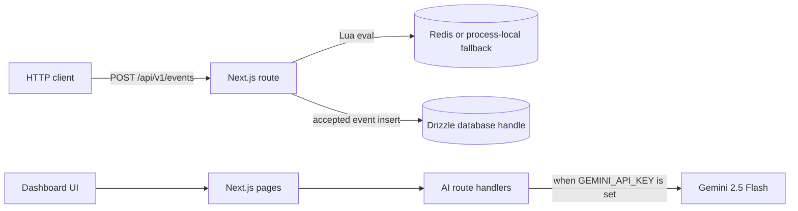

# MeterFlow

MeterFlow is a Next.js prototype exploring usage-based billing and FinOps workflows. It includes dashboard screens, billing calculation utilities, an event ingestion route, AI route handlers, and a Drizzle PostgreSQL schema. Several screens use hard-coded sample data, and the API integrations are not wired into a complete production service. Treat this as a portfolio prototype, not a production billing system.

## Run locally

Requirements: Node.js and npm.

```bash
npm install
npm run dev
```

Open <http://localhost:3000>. The login UI offers a demo option that stores a session-like object in browser `localStorage`; it bypasses authentication and does not load a pre-seeded database. Dashboard pages render sample data.

Optional environment variable names are listed in [.env.example](.env.example). Redis is configured from `UPSTASH_REDIS_REST_URL` and `UPSTASH_REDIS_REST_TOKEN`; the AI handlers read `GEMINI_API_KEY`. The repository does not include a database connection initializer or migrations, and accepted event writes require the database handle to be initialized elsewhere.

## Architecture



The diagram describes the code paths and configured integrations, not a deployed or end-to-end verified system. The Redis client has an in-process map fallback when no Redis URL is supplied. That fallback is local to one Node.js process and is not shared across instances; it also lacks the `eval` method called by the ingestion route. The route therefore needs a Redis client with script evaluation. It has fixed placeholder tenant/customer IDs, and no customer SDK, background worker implementation, or migration workflow is included.

## Billing calculations

`src/lib/billing-engine/rating.ts` dispatches across five pricing models. The caller supplies billable units after any free allowance is accounted for.

| Model | Calculation in the implementation |
| --- | --- |
| `FLAT` | Returns the configured fee. |
| `PER_UNIT` | `round(units * unitPriceMicros)`. |
| `GRADUATED_TIERED` | Prices units in each reached band and adds that band's flat fee. |
| `VOLUME_TIERED` | Selects one band, then prices the full quantity at its rate and fee. |
| `BLOCK_PACKAGE` | `ceil(units / blockSize) * blockPriceMicros`. |

Prices are expressed in micro-dollars (`1 USD = 1,000,000 micro-dollars`). Rating currently uses JavaScript `number` arithmetic and rounds some model results to integer micro-dollars; it does not provide an all-`bigint` calculation path. `src/lib/billing-engine/credits.ts` uses `bigint` for credit amounts, filters grants that expire on or before the invoice period end, then consumes grants by expiration date and ascending priority. These are calculation utilities; invoice generation and transactional persistence are not implemented as a complete flow.

## Event ingestion API

`POST /api/v1/events` accepts a JSON body with an `events` array (maximum 500). Each event needs `idempotency_key`, `external_customer_id`, `event_name`, and a parseable `timestamp` for the code path to work; `properties` is optional.

```json
{
  "events": [
    {
      "idempotency_key": "evt-001",
      "external_customer_id": "customer-001",
      "event_name": "llm_tokens",
      "timestamp": "2026-01-15T10:00:00Z",
      "properties": { "tokens": 1200 }
    }
  ]
}
```

The handler calls the Redis Lua script in `src/lib/redis/lua-scripts.ts`. The script increments a request counter keyed by event timestamp second, sets an idempotency key with a 24-hour TTL, checks a hard cap, and updates usage/spend counters. In the route, the configured request limit is 500 and the hard/soft caps are passed as `-1` (disabled); quantity and cost deltas are fixed at `1` and `150`. Accepted events are then inserted through the Drizzle handle. Responses include per-event outcomes such as `ACCEPTED`, `DUPLICATE_IGNORED`, `RATE_LIMITED`, `HARD_CAP_BLOCKED`, or `INVALID`.

Scope limits: the route does not authenticate API keys or resolve a tenant from the request. It uses placeholder organization/customer UUIDs. The exported database handle is not initialized elsewhere in the app, so accepted writes need additional initialization. The Redis counter can be updated before the database insert, and no transactional/outbox flow joins those operations. The GET handler in the same file evaluates customer spend caps using database data and Redis usage, but it also relies on placeholder tenant context. Treat these handlers as implementation sketches, not a production-ready metering API.

## Data model

`src/db/schema.ts` defines 18 PostgreSQL tables using Drizzle:

- **Identity and tenancy:** organizations, users, org memberships, API keys.
- **Catalog and accounts:** customers, billable metrics, plans, plan prices, subscriptions, credit grants.
- **Metering and billing:** raw usage events, hourly usage rollups, invoices, invoice line items.
- **Integrations and audit:** webhook endpoints, webhook deliveries, processed Stripe events, audit logs.

The schema includes organization-scoped uniqueness for memberships, customers, metrics, and usage idempotency, plus indexes for customer/event/time lookups and hourly rollups. Monetary columns use PostgreSQL `bigint` in micro-dollars, while tier configuration is stored in JSONB and its price fields are JavaScript numbers. These are schema definitions only; a database connector/migration setup is not currently wired in this repository.

## Other code areas

- `src/app/(dashboard)/` contains overview, events, metrics, plans, customer, invoice, webhook, simulator, and copilot screens. Much of their displayed data is local sample data.
- `src/app/api/ai/` contains copilot, natural-language filter, and anomaly handlers. They use deterministic canned responses without `GEMINI_API_KEY` and call Gemini 2.5 Flash when configured. The copilot prompt requests read-only SQL, but the route does not execute the generated SQL against the database.
- `src/lib/crypto.ts` contains API key hashing helpers and webhook HMAC signing/verification utilities. Their presence does not mean the ingestion route currently validates API keys.
- `src/app/api/webhooks/stripe/route.ts` is a Stripe webhook route; it is not a complete billing synchronization pipeline.

## Tests and scripts

Run the available unit tests with:

```bash
npm test
```

There are two Vitest files with 23 cases: 19 rating/credit tests in `tests/rating-engine.test.ts` and 4 idempotency examples in `tests/ingestion-idempotency.test.ts`. The latter tests a local mock map; it does not invoke the API handler, Redis script, real concurrent requests, or database persistence. No Playwright test configuration or E2E test script is present.

Available npm scripts from `package.json`:

| Script | Purpose |
| --- | --- |
| `npm run dev` | Start Next.js development server. |
| `npm run build` | Create a Next.js production build. |
| `npm run typecheck` | Run `tsc --noEmit`. |
| `npm run lint` | Run ESLint over TypeScript files. |
| `npm test` | Run Vitest. |
